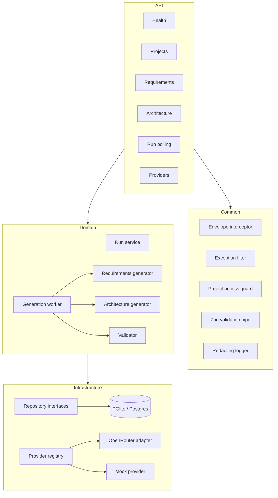
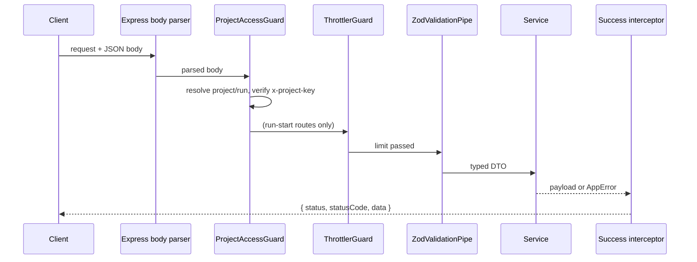

# Architecture

The backend is one NestJS process with an in-process generation worker. Persistence and model access sit behind interfaces so drivers and vendors can change without touching orchestration.

## Module map

| Location | Responsibility |
| --- | --- |
| `src/common/` | Envelope interceptor and exception filter, error registry mapping, Zod pipe, access guard, access-key service, redaction. |
| `src/config/` | Zod-validated environment; single source of `process.env` reads. |
| `src/database/` | `DatabaseService`, Drizzle schema, migrations, repository interfaces and implementations. |
| `src/providers/` | `ModelProvider` boundary, registry, OpenRouter adapter, mock provider, schema sanitizer, prompts. |
| `src/generation/` | Run service, DB-backed worker, requirements and architecture generators, run DTO mapping. |
| `src/projects/`, `src/requirements/`, `src/architecture/` | HTTP controllers and domain services. |
| `src/architecture/validator.ts` | Structural and semantic validation of the merged canonical model. |
| `packages/contracts/` | Zod schemas, DTO types, error-code registry, envelope helpers. |

## Request lifecycle

Failures bypass the success interceptor and are normalized by `AllExceptionsFilter` into `{ status: false, statusCode, message, error: { code, details? } }`. The `statusCode` in the body always equals the HTTP status.

## Access control

- `POST /api/projects` returns a 256-bit random Base64URL access key once.
- Only its SHA-256 hex hash is stored in `project_access`.
- Every project-scoped route and `GET /api/runs/:runId` requires `x-project-key`.
- Verification uses `timingSafeEqual`.
- The guard strips the stored hash before exposing the project to controllers.

Run polling resolves the run first, then checks the key against that run's project. A run id cannot be enumerated without a valid key; an unknown run returns `RUN_NOT_FOUND`.

## Configuration

`loadConfig()` validates `process.env` with Zod at module creation and refuses to boot on invalid values. `DATABASE_DRIVER=postgres` requires `DATABASE_URL`.

| Variable | Default | Purpose |
| --- | --- | --- |
| `PORT` | `3001` | HTTP port. |
| `CORS_ORIGIN` | `http://localhost:3000` | Comma-separated allowed origins. |
| `DATABASE_DRIVER` | `pglite` | `pglite` or `postgres`. |
| `PGLITE_DATA_DIR` | `.data/pglite` | PGlite directory; `memory://` in tests. |
| `DATABASE_URL` | — | Required for Postgres. |
| `GENERATION_CONCURRENCY` | `1` | Reserved; the worker is single-run. |
| `GENERATION_POLL_INTERVAL_MS` | `100` | Worker polling cadence. |
| `MOCK_PROVIDER` | `0` | Explicit deterministic mock provider. |
| `DEFAULT_PROVIDER` | `openrouter` | Provider when the request omits one. |
| `DEFAULT_MODEL` | `z-ai/glm-5.3-flash` | Model when the request omits one. |
| `MAX_REQUEST_BYTES` | `1000000` | JSON body limit. |
| `THROTTLE_LIMIT` | `10` | Run-start requests per IP per window. |
| `THROTTLE_TTL_MS` | `3600000` | Throttle window. |

No `.env` loader is installed: set environment variables in the shell or the process manager. This keeps secrets out of the repository and makes deployment configuration explicit.

## Deliberate boundaries

- No React Flow or rendering concerns in the backend; it returns the canonical model only.
- No Redis, BullMQ, or multi-instance worker in the MVP. The database queue is claimed by one in-process worker.
- Repository interfaces keep PGlite and Postgres interchangeable. No SQL leaks into controllers or generators.
- Provider adapters are created only through `ProviderRegistry`; orchestration never imports OpenRouter directly.
- The Express adapter is constructed explicitly in `main.ts` so production boot does not depend on Nest's optional platform discovery under npm workspace hoisting.
- The mock provider is active only when `MOCK_PROVIDER=1` is explicitly set.

Related: [[Home]] · [[API]] · [[Data-Model]] · [[Generation]] · [[Providers]] · [[Testing]]
