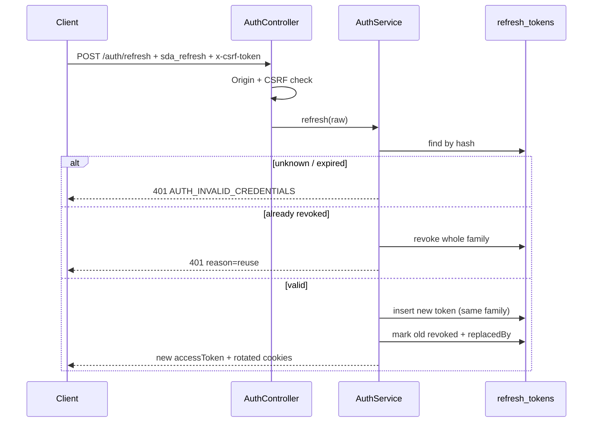

# Authentication

Email + password accounts with scrypt hashes, short-lived Bearer sessions, a rotating refresh cookie, single-use email tokens, and optional email verification. Related: [[API]] · [[Data-Model]] · [[Architecture]].

## Credential storage

| Secret | Storage | Notes |
| --- | --- | --- |
| Password | `users.password_hash` (scrypt, per-password salt) | `PasswordService`; unknown-email login runs a dummy verify so timing does not leak existence. |
| Access token | `auth_sessions.token_hash` (SHA-256) | Opaque random value returned as `accessToken`; TTL `ACCESS_TOKEN_TTL` (default 15m). |
| Refresh token | `refresh_tokens.token_hash` (SHA-256) | Cookie only, never in a body. TTL `REFRESH_TOKEN_TTL` (default 30d). |
| Email verification | `email_verification_tokens.token_hash` | 24 h TTL, consumed once, hash only. |
| Password reset | `password_reset_tokens.token_hash` | 1 h TTL, single use. |

No raw token is ever persisted in production. The development outbox stores usable links so a developer can follow them; production stores only a `<redacted>` placeholder and the route is hidden when `NODE_ENV=production`.

## Cookies and CSRF

| Cookie | Flags | Purpose |
| --- | --- | --- |
| `sda_refresh` | `httpOnly`, `SameSite=Strict`, `Secure` in production, `path=/api/auth` | Refresh token. |
| `sda_csrf` | readable by the page, `SameSite=Strict`, `Secure` in production, `path=/` | Double-submit nonce. |

`AuthCookieService.assertCsrf()`:

1. If an `Origin` header is present it must be in `CORS_ORIGIN` (`origin_not_allowed` otherwise).
2. When the CSRF cookie exists, `x-csrf-token` must equal it (`csrf_invalid` otherwise). With `CSRF_SECRET` set, the cookie is `<nonce>.<hmac>` and the signature is verified too.
3. `POST /api/auth/logout` accepts a Bearer-only request without CSRF so existing header clients keep working; anything cookie-authenticated needs the header.

`x-csrf-token` is in the CORS `allowedHeaders` list and CORS credentials are enabled so the browser can send cookies.

## Endpoints

| Route | Auth | Behavior |
| --- | --- | --- |
| `POST /api/auth/register` | — | Creates the account, queues a verification email, returns a Bearer session and sets both cookies. |
| `POST /api/auth/login` | — | Same session contract. Allowed even when verification is required; generation is gated instead. |
| `POST /api/auth/refresh` | refresh cookie + CSRF | Rotates the refresh token and issues a new access session. |
| `POST /api/auth/logout` | Bearer and/or refresh cookie | Deletes the access session, revokes the refresh family, clears cookies. A refresh cookie plus `x-csrf-token` is enough; no Bearer token is required. |
| `POST /api/auth/verify-email` | token | Consumes the token and sets `email_verified_at`. |
| `POST /api/auth/resend-verification` | Bearer | Issues a fresh token; no-op when already verified. |
| `POST /api/auth/forgot-password` | — | Always 200. Creates a reset token only when the account exists. |
| `POST /api/auth/reset-password` | token | Consumes the token, updates the hash, deletes all sessions and revokes all refresh families. |
| `DELETE /api/users/me` | Bearer + CSRF | Re-verifies the password, then deletes the user. |
| `GET /api/dev/outbox` | — | Development only; 404 in production. Returns the last 50 messages. |

`GET /api/auth/me` returns `emailVerifiedAt` (ISO string or `null`).

## Refresh rotation and reuse detection

If the conditional rotation loses a race (`revokedAt` already set), the new row is revoked and the family is invalidated.

## Email delivery

`EmailService` is the delivery boundary. The only implementation, `OutboxEmailService`, writes `dev_outbox` rows (kind, recipient, link) and logs metadata only. Outside production the stored link contains the raw token so a developer can follow it; in production the link is stored with `token=<redacted>` and a warning is logged, because no SMTP transport exists yet. Wire a real provider behind `EMAIL_SERVICE` before public launch.

Links use `APP_BASE_URL`:
`<APP_BASE_URL>/verify-email?token=…` and `<APP_BASE_URL>/reset-password?token=…`.

## Verification gate

`REQUIRE_EMAIL_VERIFICATION=true` adds `RequireVerifiedEmailGuard` to project creation and every run start (requirements, architecture, regenerate). The guard returns 401 `AUTH_REQUIRED` with `details.reason = "email_not_verified"` until `email_verified_at` is set. Default is `false` for local development.

## Throttling

`AuthThrottlerGuard` applies `AUTH_THROTTLE_LIMIT` per `AUTH_THROTTLE_TTL_MS` (default 5 per 60 s) per IP and route to register, login, verify, resend, forgot, and reset. A blocked request is `429 QUOTA_EXCEEDED` with a `Retry-After` header. Run starts keep the separate `THROTTLE_*` budget. Token durations must be at least `1s`; `0s` fails boot.

## Error codes

Authentication failures reuse the existing registry: `AUTH_REQUIRED`, `AUTH_INVALID_CREDENTIALS`, `AUTH_EMAIL_TAKEN`. Reasons live in `error.details.reason` (`token_invalid`, `verification_invalid`, `reset_invalid`, `reuse`, `csrf_invalid`, `origin_not_allowed`, `email_not_verified`). No new code was added because the frontend keeps an exhaustive message map; follow up there before introducing new codes.

## Account deletion

`DELETE /api/users/me` requires the current password. The users row is deleted; `projects.owner_id` is set null by the FK, while sessions, tokens, provider config, preferences, subscriptions, and billing events cascade. Orphaned projects stay readable with their `x-project-key`.

Related: [[Home]] · [[API]] · [[Data-Model]] · [[Architecture]] · [[Testing]]
