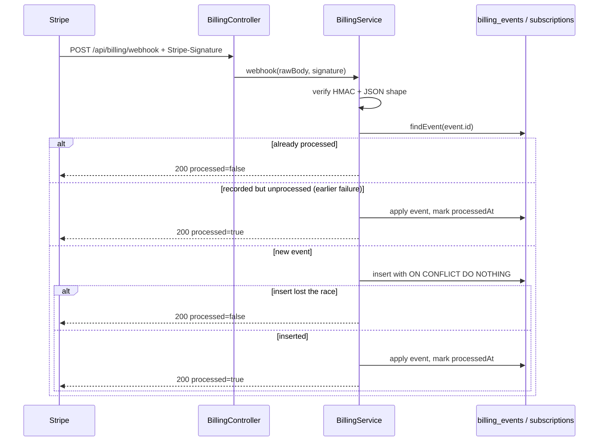

# Billing

Plans are enforced by `PlanService` and described by one catalogue in `@sda/contracts` (`PLAN_CATALOG`), served by `GET /api/billing/plans`. **No real charge is created by this backend in development.**

## Provider abstraction

```ts
interface BillingProvider {
  id: "stub" | "stripe";
  checkoutCompletable: boolean;
  createCheckout(input): Promise<{ checkoutId; url }>;
  createPortal(user, subscription): Promise<{ url }>;
  cancel(subscription): Promise<void>;
  completeCheckout?(checkoutId, userId): Promise<void>; // stub only
  parseWebhook({ rawBody, signature }): Promise<WebhookEvent | null>;
}
```

`BillingModule` picks the provider: `STRIPE_SECRET_KEY` present → `StripeBillingProvider`, otherwise `StubBillingProvider`.

| Provider | Checkout | Completion | Portal | Cancel |
| --- | --- | --- | --- | --- |
| `stub` (default) | In-memory session, URL `<APP_BASE_URL>/billing/checkout/<id>` | `POST /api/billing/checkout/:id/complete`, non-production only | `<APP_BASE_URL>/account/billing` | Immediate local downgrade to Free |
| `stripe` | Checkout Session via REST + fetch (needs `STRIPE_PRICE_PRO`) | Stripe-hosted | Billing Portal Session | `cancel_at_period_end`; downgrade on `customer.subscription.deleted` |

The Stripe adapter uses form-encoded REST calls; no SDK dependency. `Stripe-Signature` is verified as HMAC-SHA256 over `<timestamp>.<raw body>` with a 5-minute tolerance; the raw body is captured by the shared JSON parser in `bootstrap.ts`.

## State

`billing_subscriptions` holds one row per user: plan, status, provider, external customer/subscription ids, period end, and `cancel_at_period_end`. `users.plan_tier` is the enforcement source used by `PlanService`.

`billing_events` is the webhook ledger: `idempotency_key` (provider event id) is unique, the payload is stored, an optional `user_id` links the event to an account (cascade on user delete), and `processed_at` marks successful processing. Checkout events take the user from `client_reference_id`; `customer.subscription.updated` / `deleted` resolve it through the stored subscription for that external id, so account deletion cascades them. An event for a subscription this backend never stored stays `user_id = null` and is retained. Insert uses `ON CONFLICT DO NOTHING`, so a concurrent duplicate is acknowledged with `{ received: true, processed: false }` instead of a 500.



Processing happens **before** `processed_at` is written, so a failure leaves the event unprocessed and a provider retry applies it. `handleEvent` is idempotent (upserts with deterministic values), so a retry after a partial write converges.

Handled types: `checkout.session.completed` (activate Pro using `client_reference_id`), `customer.subscription.updated` (status/period, downgrade when not `active`/`trialing`), `customer.subscription.deleted` (canceled, Free). Other events are recorded and acknowledged.

## Endpoints

| Route | Auth | Notes |
| --- | --- | --- |
| `GET /api/billing/plans` | — | Catalogue, active provider, `checkoutCompletable`. |
| `GET /api/billing/subscription` | Bearer | `{ subscription, planTier }`; `subscription` is null on Free. |
| `POST /api/billing/checkout` | Bearer | `{ plan: "pro" }` → `{ checkoutId, url, provider }`. In production with the stub provider the plan catalogue reports `checkoutCompletable: false` and this route returns 502 `PROVIDER_UNAVAILABLE`. |
| `POST /api/billing/checkout/:id/complete` | Bearer | Stub only; 404 in production or when the id is unknown/foreign. |
| `POST /api/billing/portal` | Bearer | Stub returns a local URL; Stripe needs an existing customer. |
| `POST /api/billing/cancel` | Bearer | Idempotent. |
| `POST /api/billing/webhook` | Stripe signature | No bearer auth. |

Errors reuse `PROVIDER_UNAVAILABLE` (upstream billing failure), `VALIDATION_ERROR` with `reason: "webhook_invalid"`, and `ROUTE_NOT_FOUND` (hidden stub route).

## Limits and upgrades

`PlanService` reads `PLAN_LIMITS`, derived from `PLAN_CATALOG`, so a plan change in contracts updates both the marketing catalogue and enforcement. Checkout completion or a webhook updates `users.plan_tier`; the next request sees the new limits with no restart.

## Known limits

- The stub keeps checkout ids in process memory: a restart loses pending checkouts. It is disabled in production because there is no completion route there.
- The Stripe path is implemented but not exercised against a live account in tests; only the webhook ledger, idempotency, and plan transitions are automated.
- No proration, invoicing, tax, or dunning logic. `priceMonthlyUsd` is display-only.

Related: [[Home]] · [[API]] · [[Data-Model]] · [[Auth]] · [[Testing]]
