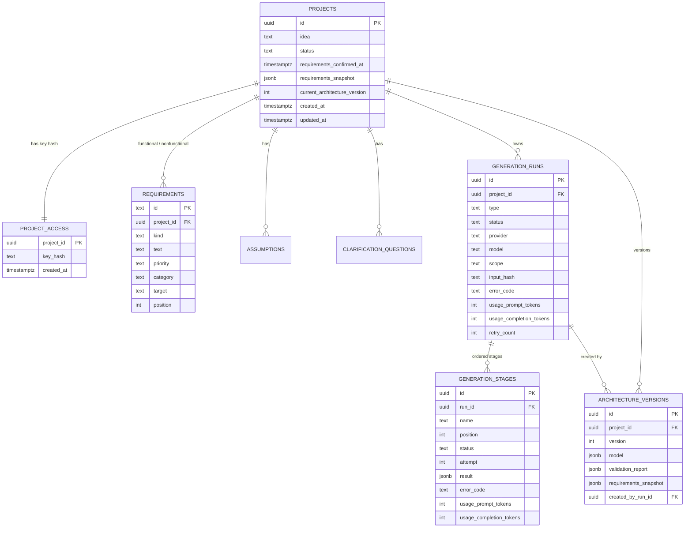
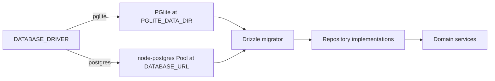

# Data Model

One Drizzle schema drives both PGlite (local/test) and Postgres (production). Enum-like columns are `text` with TypeScript union types from `@sda/contracts`; the database keeps the same SQL shape across drivers.

## Entity relationships

## Tables

| Table | Key constraints and indexes |
| --- | --- |
| `projects` | UUID primary key; status union; snapshot JSONB; index on `created_at`. |
| `project_access` | `project_id` primary key and FK with cascade; stores only SHA-256 hex of the access key. |
| `requirements` | Text id primary key (prefix `fr_` / `nfr_`), project FK cascade; `(project_id, position)` index. |
| `assumptions` | Text id primary key (`asm_`), project FK cascade; `(project_id, position)` index. |
| `clarification_questions` | Text id primary key (`q_`), project FK cascade; `(project_id, position)` index. |
| `generation_runs` | UUID primary key; project FK cascade; partial unique index `runs_one_active_project_idx` on `project_id` where status is `queued` or `running`; `(project_id, created_at)` and `(status, created_at)` indexes. |
| `generation_stages` | UUID primary key; run FK cascade; unique `(run_id, name)`; index `(run_id, position)`. |
| `architecture_versions` | UUID primary key; unique `(project_id, version)`; indexes on `(project_id, created_at)`; `created_by_run_id` set null when a run is deleted. |

## JSONB payloads

- `projects.requirements_snapshot` — immutable `ConfirmedRequirements` (`{ confirmedAt, spec }`) written only on explicit confirmation.
- `generation_stages.result` — stage-specific data: the validated HLD for `hld_model`, the LLD/DSA section for `lld_dsa_model`, the validation report for `validate`, or `{ scope, validation }` for scoped regeneration.
- `architecture_versions.model` — the complete canonical `ArchitectureModel`.
- `architecture_versions.validation_report` — `{ valid, errors, warnings, validatedAt }`.
- `architecture_versions.requirements_snapshot` — the exact snapshot used to build that version, so later requirement edits do not rewrite history.
- `generation_runs.error_details` / `generation_stages.error_details` — safe, bounded diagnostic context. Never secrets or full raw provider output.

## ID conventions

| Prefix | Entity |
| --- | --- |
| `fr_`, `nfr_` | Functional / non-functional requirements |
| `asm_` | Assumption |
| `q_` | Clarification question |
| `cls_`, `rel_`, `pat_` | LLD class, relationship, pattern |
| `cmp_`, `conn_`, `flow_` | HLD component, connection, flow |
| `tech_`, `scale_`, `fail_` | Technology decision, scalability note, failure scenario |
| `dsa_`, `alg_` | DSA recommendation, algorithmic pattern |
| `step_` | Learning step |

Requirement ids are server-assigned on first generation and preserved by clients on edit. Architecture ids are model-generated and validated against prefix regexes in `@sda/contracts`.

## Migrations

- Schema source: `src/database/schema.ts`.
- Generated SQL: `drizzle/0000_first_lyja.sql` (initial tables) and `drizzle/0001_loving_nick_fury.sql` (active-run partial unique index), with metadata under `drizzle/meta/`.
- Generate after schema edits: `npm run db:generate` (drizzle-kit, generate-only config).
- Apply: `DatabaseService.onModuleInit()` runs the appropriate Drizzle migrator on boot. Migrations are idempotent and recorded in Drizzle's migrations table.
- The migrations folder is resolved relative to the compiled/source database service, so both `src` and `dist` execution find `backend-server/drizzle`.

## Driver selection

- `pglite` default: `.data/pglite`, or `memory://` for tests.
- Concurrent double-starts are rejected by the database, not only by the service check: the partial unique index allows at most one `queued`/`running` row per project, and the violation maps to `RUN_CONFLICT`.
- `postgres`: requires `DATABASE_URL`; the `pg` module is imported dynamically so PGlite local runs do not load it.
- Both paths expose the same `AppDatabase` union and repositories. Domain code never imports a Drizzle driver directly.
- PGlite is single-process/single-connection. This is acceptable for one API instance and worker concurrency 1; production must use Postgres.

## Access-key storage

The raw key is returned only by project creation. `AccessKeyService` hashes it with SHA-256 and the guard compares hashes with `timingSafeEqual`. A database leak therefore does not expose usable keys, and the 256-bit random space makes brute force infeasible.

Related: [[Home]] · [[Architecture]] · [[Generation]] · [[API]] · [[Providers]] · [[Testing]]
