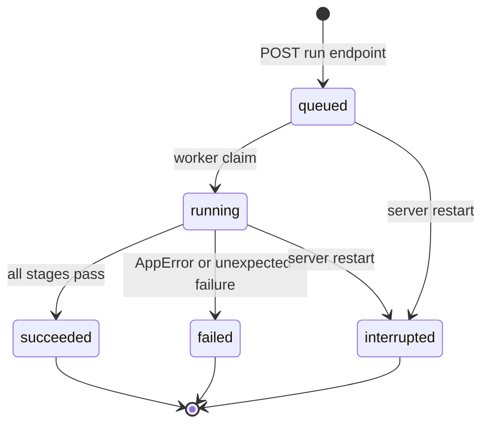
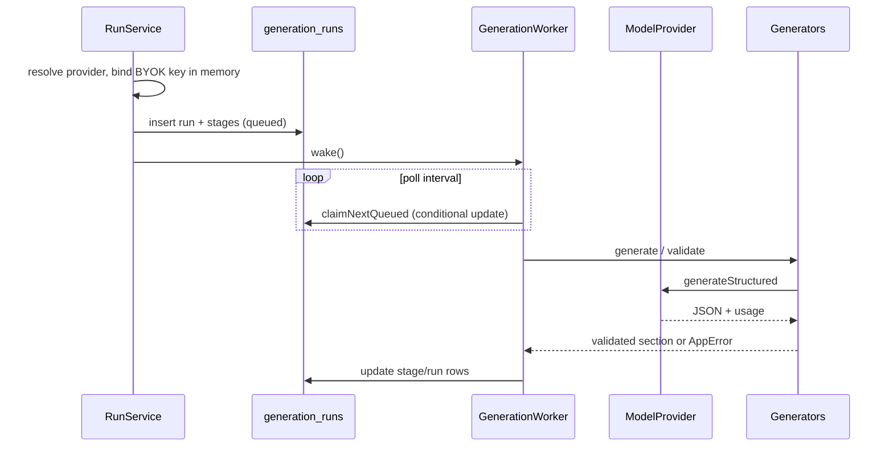
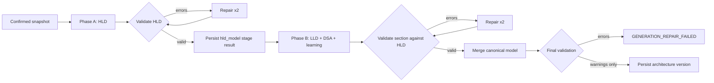

# Generation

Generation is asynchronous and DB-backed. The API queues a run, an in-process worker claims it, and every stage transition is persisted before it is returned to clients.

## Run lifecycle

- One active run per project is enforced twice: `RunService.hasActiveRun()` for a clean `RUN_CONFLICT`, and a partial unique index on `generation_runs(project_id)` where status is `queued` or `running` for concurrent double-POSTs.
- The unique-violation path is translated to `RUN_CONFLICT`.
- A failed or interrupted run does not block a retry.
- At startup, `reconcileInterrupted()` marks every queued/running run as `interrupted` and its pending/running stages as `failed`. There is no silent auto-restart.

## Stages

| Run type | Stage order |
| --- | --- |
| Requirements | `analyze_idea`, `persist` |
| Full architecture | `hld_model`, `lld_dsa_model`, `validate`, `persist` |
| Scoped regeneration | `<scope>_model` (`hld_model`, `lld_model`, or `dsa_model`), `validate`, `persist` |

Each row starts `pending`, becomes `running` when work begins, then `succeeded` or `failed`. Attempts, timestamps, token usage, and safe error details are stored on the row. The run DTO orders stages by persisted position; no stage is simulated.

## Worker

Key properties:

- Concurrency 1: one tick at a time, one run per tick.
- The provider instance for a run is registered in an in-memory `Map<runId, ModelProvider>` before the run row is created. It is deleted in `finally`, whether the run succeeds or fails.
- The BYOK key exists only inside the bound provider closure; it is never written to the database or logs.
- If the server restarts, the map is empty. Reconciliation marks the old run interrupted rather than trying to continue without credentials.
- A claimed run missing its in-memory provider fails with `PROVIDER_AUTH_FAILED`.
- Defensive tick failures are logged; the interval keeps polling.

## Requirements pipeline

1. `analyze_idea` calls the model with the requirements schema, `maxOutputTokens=4000`, timeout 90s, temperature 0.2.
2. Output is validated as `RequirementsAnalysisOutputSchema`.
3. On schema or JSON failure, one repair attempt includes the exact failing rules and the previous output.
4. Exhausted repairs produce `GENERATION_REPAIR_FAILED` with `stage` and bounded `issues`.
5. Valid output receives server-assigned `fr_`, `nfr_`, `asm_`, and `q_` ids.
6. `persist` replaces the project's editable specification and resets confirmation (`requirements_ready`, no snapshot).

The user then edits and confirms the spec via `PUT /requirements`. Confirmation writes an immutable `ConfirmedRequirements` snapshot used by architecture generation.

## Two-phase architecture pipeline

- Phase A (`hld_model`) generates components, connections, flows, technology decisions, scalability notes, and failure scenarios. Budget: 32k output tokens, 600s. The prompt targets 6-12 components, 8-16 connections, and 1-2 flows; every component must appear in a connection.
- Phase B (`lld_dsa_model`) generates classes, relationships, patterns, DSA recommendations, learning steps, and model metadata, with the HLD pinned as context. Budget: 64k output tokens, 900s. The prompt targets 8-14 classes, 10-20 relationships, 2-5 patterns, 3-5 DSA recommendations, and 4-8 learning steps. Reasoning effort defaults to `low` on OpenRouter, but reasoning tokens still share the output budget; GLM-5.3 Flash uses a large share even at low. A truncated response fails fast instead of repeating the same over-budget repair.
- Each phase gets at most 3 attempts: initial + 2 repairs. Repairs include the exact validation issue list and the previous output.
- A failed Phase B leaves the successful Phase A stage row intact.
- `findReusableHld()` can reuse a validated HLD from an earlier failed/interrupted full run with the same requirements hash and valid structure. This avoids paying for Phase A twice.
- `validate` runs the full structural + semantic validator on the merged model, including relationship type and multiplicity compatibility. Structural errors fail the run; warnings are stored in the version report.
- **LLD connectivity:** every class, abstract class, and interface should have at least one relationship. `enum` and `value_object` may stand alone only as member types. Orphan classes are reported as `orphan_class` warnings; the prompt asks the model to connect them, but a valid diagram is still persisted for flexibility.
- **HLD connectivity:** every component should appear in at least one connection. Orphan components are reported as `orphan_component` warnings; the prompt asks the model to connect them.
- **Design-pattern catalog:** the LLD prompt carries a candidate catalog (creational, structural, behavioral, plus the Null Object special idiom). It is not a checklist: 2-5 justified patterns are preferred, and pattern participants must be connected by relationships that express the pattern. Method signatures must start with `(` and must not repeat the method name.
- `persist` allocates `max(version)+1`, writes `architecture_versions`, points the project at it, and sets `architecture_ready`.

### Provider calls per run

Only requirements, HLD, and LLD/DSA call the model. Validation and persistence are local.

| Phase | Provider calls | Notes |
| --- | --- | --- |
| Project creation | 0 | Local DB write. |
| Requirements analysis | 1 + up to 1 repair = 1–2 | `analyze_idea` stage. |
| HLD | 1 + up to 2 repairs = 1–3 | `hld_model` stage. Skipped when a compatible HLD is reused. |
| LLD + DSA + learning | 1 + up to 2 repairs = 1–3 | One combined `lld_dsa_model` stage. |
| Validation + persistence | 0 | Local code. |

A full architecture from an idea is therefore **3–8 model calls** including requirements. A retry with HLD reuse is **2–5 calls**. Each repair is another full model request with the previous output and the failing issues; calls run sequentially, never in parallel. In a local sample of successful runs, requirements used 1 call, HLD used 3 (when newly generated), and LLD/DSA used 3; the latest run reused HLD and used 3 LLD/DSA calls, totaling 64,230 tokens.

### Token optimizations

- **Previous output is sent once per repair.** The repair user message contains it; the generator no longer also adds it as an assistant message.
- **Prompt context is compacted.** LLD/DSA prompts receive ids, names, types, relationships, and short intent instead of the full HLD/LLD rationale/trade-off prose. This cuts the HLD JSON about 40% and the LLD JSON about 53% on the live sample. A scoped LLD regeneration after these changes used **2 attempts, 10,208 prompt + 11,987 completion = 22,195 tokens**, versus the previous full LLD stage at **3 attempts, 45,283 + 18,947 = 64,230 tokens**.
- **Deterministic validation mistakes are normalized before parsing.** Composition/aggregation source multiplicity becomes `"1"`; inheritance/realization becomes `"1"` on both ends. Learning refs that are not architecture element ids are dropped; steps with no valid refs are removed. Invalid requirement refs are filtered.
- **HLD reuse** skips the HLD call on retry when the requirements hash and a valid HLD match.
- **Concise targets**: HLD 6–12 components / 8–16 connections / 1–2 flows; LLD 8–14 classes / 10–20 relationships / 2–5 patterns / 3–5 DSA recommendations / 4–8 learning steps. `max_tokens` is a cap, not a reservation; actual output is billed.

## Scoped regeneration

`POST /architecture/regenerate` accepts `hld`, `lld`, or `dsa`:

1. Load the current architecture version.
2. Summarize the requirements diff between the version's snapshot and the current confirmed spec.
3. Regenerate only the requested section.
4. Merge it with the pinned untouched sections.
5. Prune learning-step references to elements removed by the new section. Pruned references become warnings.
6. If every learning step loses all references, fail with `GENERATION_REPAIR_FAILED` and tell the user to regenerate the full architecture.
7. Validate the merged model, then persist a new version.

DSA regeneration does not touch `hld` or `lld`; the e2e suite asserts the untouched sections serialize byte-for-byte identically to the previous version. HLD regeneration keeps the LLD/DSA objects but prunes any learning references that no longer resolve.

## Failure mapping

| Condition | Run error |
| --- | --- |
| Missing or invalid provider key | `PROVIDER_AUTH_FAILED` |
| Provider 429 | `PROVIDER_RATE_LIMITED` (with `retryAfterSeconds` when supplied) |
| Provider timeout / 408 / 504 | `PROVIDER_TIMEOUT` |
| Provider network / 5xx | `PROVIDER_UNAVAILABLE` |
| Context length or capability rejection | `PROVIDER_UNSUPPORTED_CAPABILITY` |
| Invalid JSON / empty / oversized output | Repaired when parseable; oversized output is rejected. If still failing after attempts, `GENERATION_REPAIR_FAILED`. |
| Truncated output (`finish_reason: length` or incomplete JSON) | Fails fast with `GENERATION_REPAIR_FAILED`; retrying with the same output budget cannot help. Issue rule `truncated_output` preserves the provider reason. |
| Schema or validator errors after repairs | `GENERATION_REPAIR_FAILED` |
| Unexpected exception | `INTERNAL_ERROR` |

`failRun()` marks the currently running stage failed, then the run failed, with the same code/message/details. Usage accumulated before the failure is retained.

## Observability

Persisted per run: status, provider, model, scope, stage timestamps, attempts/retry count, prompt and completion tokens, error code/message/details. Per version: full validation report with warning list and `validatedAt`. Duration is derivable from `createdAt`/`startedAt`/`finishedAt`.

No raw provider payloads are stored or logged. Stage `result` holds only validated structured data and validation reports.

Related: [[Home]] · [[Architecture]] · [[Providers]] · [[Data-Model]] · [[Testing]]
