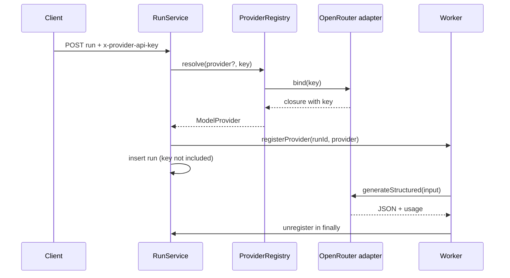

# Providers

Model access is isolated behind `ModelProvider`. Orchestration depends on the interface and `ProviderRegistry`, never on a vendor SDK or URL.

## Boundary

```ts
interface ModelProvider {
  id: string;
  generateStructured(input: {
    model: string;
    system: string;
    messages: ChatMessage[];
    schemaName: string;
    jsonSchema: JsonSchemaObject;
    maxOutputTokens: number;
    timeoutMs: number;
  }): Promise<{ data: unknown; usage?: TokenUsage }>;
}
```

`src/providers/model-provider.ts` is the only contract generators use. The registry resolves a provider for one run and binds the BYOK key in memory.

## Registry rules

- `MOCK_PROVIDER=1` takes precedence and always returns the deterministic mock, regardless of the requested provider.
- Otherwise, `provider` from the request (or `DEFAULT_PROVIDER`, default `openrouter`) must be `openrouter` or `groq`; anything else is `VALIDATION_ERROR` with the available provider list.
- A real run without `x-provider-api-key` fails immediately with `PROVIDER_AUTH_FAILED`, unless the matching local `.env` key is set (development only).
- `GET /api/providers` returns the registered provider metadata, the env defaults, and the mock flag. It never returns a key.
- `DEFAULT_MODEL` is the active default model when a request omits one. Each provider exposes a model catalog from configuration only — no provider API is called to discover models:
  - `OPENROUTER_MODELS` (comma-separated) defaults to `z-ai/glm-5.3-flash` plus a small curated fallback list.
  - `GROQ_MODELS` (comma-separated) defaults to the common Groq chat models used by the adapter.
  - Values are trimmed, de-duplicated, and blank entries dropped; an empty catalog fails boot.
- `MOCK_PROVIDER=1` still reports both providers with their full catalogs; only generation is mocked. No generation module hardcodes a model slug.
- Migration: `OPENROUTER_MODEL` / `GROQ_MODEL` are renamed to `OPENROUTER_MODELS` / `GROQ_MODELS` (comma-separated). The singular names are ignored, so move an existing value into the plural variable.
- Keep `DEFAULT_MODEL` inside the selected provider's catalog so the client dropdown shows the active default. This is a configuration convention, not a validated constraint: a model outside the catalog still runs when the key allows it.

## BYOK flow



- Request-supplied keys are never written to the database, stage results, error details, or metrics. The local fallback key is loaded from the gitignored `.env` into process memory only.
- The provider map entry exists only while the run is in flight; a restart loses it and reconciliation marks the run `interrupted`.
- Redacting logger and `redactSecrets` are the last line of defence for accidental messages.

### Local development fallback

`backend-server/.env` may set `OPENROUTER_API_KEY` and/or `GROQ_API_KEY` so manual testing does not require the provider dialog on every run. `main.ts` loads `.env` when present; shell and process-manager variables win. `ProviderRegistry` uses the matching fallback only when:

- `x-provider-api-key` is absent or blank,
- `NODE_ENV` is not `production`.

The request header always wins. `/api/providers` never returns either key. Production remains BYOK; do not set this variable in a deployed environment.

## OpenRouter adapter

Request: `POST https://openrouter.ai/api/v1/chat/completions` with `Authorization: Bearer <key>`, `Content-Type: application/json`, `X-Title: System Design All-in-One`, `temperature: 0.2`, `max_tokens` from the stage budget, `reasoning: { effort }` from `OPENROUTER_REASONING_EFFORT`, and an `AbortController` timeout.

`OPENROUTER_REASONING_EFFORT` defaults to `low`; set it to `off` to omit the parameter. Reasoning tokens share the `max_tokens` budget with visible output on OpenRouter, so leaving effort at the model default (`max`) can truncate large JSON responses.

### Structured-output ladder

The adapter tries modes in order and caches the working mode per model in memory:

1. **`json_schema`** — `response_format: { type: "json_schema", json_schema: { name, strict: true, schema } }` plus `provider: { require_parameters: true }`.
2. **`json_object`** — `response_format: { type: "json_object" }`, JSON Schema inlined in the system message.
3. **`prompt`** — no `response_format`, schema in the system message, tolerant extraction from code fences or surrounding prose.

A capability error in a non-final mode moves down the ladder. A capability error in `prompt` mode becomes `PROVIDER_UNSUPPORTED_CAPABILITY`. Parsing is tolerant in all modes because Dart/GLM-style providers sometimes wrap JSON; server-side Zod validation remains the authority.

### Error normalization

| Provider condition | Error code | Notes |
| --- | --- | --- |
| Blank key, 401, 403 | `PROVIDER_AUTH_FAILED` | No provider request for a blank key. |
| 429 | `PROVIDER_RATE_LIMITED` | `details.retryAfterSeconds` parsed from `Retry-After` (seconds or HTTP date). |
| Abort, 408, 504 | `PROVIDER_TIMEOUT` | Includes `timeoutMs` for aborts. |
| Context length message | `PROVIDER_UNSUPPORTED_CAPABILITY` | `details.reason = "context_length"`. |
| Capability rejection of `response_format` | ladder fallback | Only for 400/404/422 with matching message. |
| Other 5xx | `PROVIDER_UNAVAILABLE` | Generic retryable message. |
| Malformed envelope, empty content, invalid JSON, or output above 1,000,000 characters | `INVALID_MODEL_OUTPUT` | Oversized output is rejected (`reason = "output_too_large"`), never stored. Truncation (`reason = "truncated_output"`/`"truncated_json"` or `finish_reason = "length"`) fails fast as `GENERATION_REPAIR_FAILED` because retrying with the same budget cannot help. Other invalid JSON may be repaired. |
| Other 4xx | `PROVIDER_UNSUPPORTED_CAPABILITY` | Redacted provider message capped at 300 chars. |
| Network failure | `PROVIDER_UNAVAILABLE` | The key is not echoed. |

### Schema sanitization

`zodToJsonSchema()` converts Zod 4 output to draft-7 and sanitizes per-node:

- removes `$schema`, `$id`, `$comment`, examples, defaults, read/write-only, deprecated, content encoding/media, and validation keywords that strict provider modes reject (`minLength`, `pattern`, `minimum`, `maxItems`, and similar);
- drops `additionalProperties: true`;
- sets `additionalProperties: false` on every object with properties;
- in strict mode (default), makes every declared property required.

Zod still validates the real payload. Provider-side schema hints are best-effort. Because strict modes drop `maxLength` and similar limits, the system prompts also require concise free-text fields.

### Stage budgets

| Stage | Schema name | Max output tokens | Timeout |
| --- | --- | --- | --- |
| Requirements | `requirements_analysis` | 4,000 | 90 s |
| HLD | `hld_model` | 32,000 | 600 s |
| LLD + DSA + learning | `lld_dsa_model` | 64,000 | 900 s |
| Scoped HLD/LLD/DSA | `hld_model` / `lld_model` / `dsa_model` | 32,000 / 64,000 / 64,000 | 900 s |

System prompts and repair prompts live in `src/providers/prompts/index.ts`. Temperature is fixed at 0.2 in the adapter.

GLM-5.3 Flash mandates reasoning. OpenRouter maps `effort: "low"` to roughly 20% of `max_tokens`, so the 32k HLD budget leaves about 26k visible and the 64k LLD/DSA budget about 51k. A 12k HLD budget truncated on a real run; the concise HLD prompt now targets 6-12 components, 8-16 connections, and 1-2 flows. Truncation errors record completion and reasoning token counts.

## Groq adapter

Request: `POST https://api.groq.com/openai/v1/chat/completions` with `Authorization: Bearer <key>`, `max_completion_tokens` from the stage budget, and `reasoning_effort` from `GROQ_REASONING_EFFORT` (default `low`). No OpenRouter `provider` routing or `X-Title` header is sent. GPT-OSS 120B supports strict `json_schema`; the shared ladder falls back to `json_object` then prompt-only if needed.

The current free-plan key is limited to **30 RPM, 1,000 RPD, 8,000 TPM, 200,000 TPD** for `openai/gpt-oss-120b`. A 64k LLD/DSA request cannot fit the 8k TPM budget. Use OpenRouter for the full 64k generation, upgrade the Groq plan, or split LLD/DSA into multiple Groq calls (not implemented yet). The adapter maps Groq `429` responses to `PROVIDER_RATE_LIMITED` with `retryAfterSeconds`.

## Verified model

| Field | Value |
| --- | --- |
| OpenRouter slug | `z-ai/glm-5.3-flash` |
| Context length | 1,048,576 tokens |
| `response_format` | Supported |
| `structured_outputs` | Supported |

The slug was verified against OpenRouter's model list. It is a default only: clients may request another model, and deployments may set `DEFAULT_MODEL`.

| Groq field | Value |
| --- | --- |
| Groq model | `openai/gpt-oss-120b` |
| Context length | 131,072 tokens |
| Strict `json_schema` | Supported (live probe) |
| Free-plan limits | 30 RPM, 1,000 RPD, 8,000 TPM, 200,000 TPD |

The Groq model and strict schema path were verified with a live probe. Free-plan TPM is the blocker for the 64k LLD/DSA stage. A full live architecture smoke passed on OpenRouter: HLD reused, LLD/DSA succeeded on attempt 3 with 64,230 tokens, 14 classes, 19 relationships, 3 patterns, 10 components, 12 connections, and 0 warnings.

## Mock provider

`MOCK_PROVIDER=1` registers `MockProvider`, which returns deterministic fixtures for `requirements_analysis`, `hld_model`, `lld_dsa_model`, `lld_model`, and `dsa_model` with fixed token usage. It is used by unit/e2e suites and local demos. It is never active unless explicitly enabled.

## Adding a provider

1. Implement `ModelProvider` in `src/providers/<vendor>/`.
2. Add it to `ProvidersModule`.
3. Register it in `ProviderRegistry.resolve()` and `list()`.
4. Map vendor failures to the registered error codes.
5. Add adapter contract tests with a mocked fetch.
6. Add the vendor to [[Testing]] and [[API]] if it changes request behavior.

No generator or worker change should be needed.

Related: [[Home]] · [[Generation]] · [[Architecture]] · [[Testing]]
