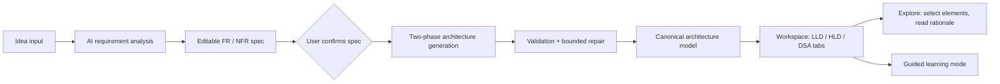

# Project Overview

## What this project is

An AI-powered software architecture learning platform aimed primarily at engineering students preparing for technical interviews (LLD, HLD, object-oriented design, and DSA rounds). It is also useful to developers exploring unfamiliar systems or sharpening their design instincts.

The user enters anything from a vague idea ("Build Spotify") to a detailed specification ("Design a distributed rate limiter"). The AI analyzes the input, proposes an editable specification, and — only after the user confirms it — generates three coordinated, explainable views of one proposed system:

1. **LLD** — an interactive UML class diagram with explained classes, methods, relationships, and applied design patterns.
2. **HLD** — an architecture diagram with components, request/event flows, technology rationale, scaling analysis, and failure scenarios.
3. **DSA** — operation-scoped analysis of the data structures, algorithms, and algorithmic patterns the design depends on, with honest complexity statements.

The product sits between a polished developer tool and an interactive engineering learning environment. It is deliberately **not** a generic chat surface.

## Who it is for

| Audience | Need |
| --- | --- |
| Engineering students | Practice and internalize LLD/HLD/DSA interview skills with real reasoning, not memorized answers. |
| Self-taught developers | Understand how systems are decomposed and why decisions are made. |
| Working engineers | Quickly explore how an unfamiliar class of system might be designed. |

Explanations must use correct software engineering terminology, stay clear and educational, and ground important ideas in concrete examples.

## Core workflow

1. **Landing page** — the user sees what the platform does and starts a design session with an idea (plus optional example prompts). First-run model setup is a single dialog: provider (OpenRouter for now) and API key.
2. **Requirements** — the AI proposes functional requirements, non-functional requirements, assumptions, and clarification questions. The user edits, adds, removes, prioritizes, resolves questions, and confirms the specification. Confirmed requirements become the contract for everything generated later.
3. **Architecture generation** — the backend regenerates a single canonical architecture model from the confirmed spec in two phases (HLD first, then LLD + DSA + learning steps bound to the HLD). Every generation stage is real and persisted; failed stages never claim success.
4. **Workspace** — three tabs over the same model. Selecting any class, relationship, component, connection, or DSA recommendation opens contextual explanations: responsibility, rationale, alternatives, trade-offs, and the requirement it serves.
5. **Guided learning** — opt-in walkthroughs that progressively reveal and highlight the already-generated diagram, step by step, with previous/next controls and an exit back to full exploration.

## Foundational product principles

- **One canonical model.** LLD, HLD, and DSA are three renderings of a single validated, structured architecture model — never three independent LLM answers.
- **Validate before render.** Model output is schema-validated and semantic-checked (unique IDs, valid references, sensible relationship types, traceable requirements). Invalid output gets bounded, targeted repair; if repair fails, the user gets a clear error, not a broken diagram.
- **Human-in-the-loop specification.** Requirements are editable before anything is generated. Assumptions are explicit, not invented facts.
- **Real progress only.** Generation shows backend stage state; no fake loading stages.
- **Understanding over generation.** Every element explains what it does, why it exists, what it costs, and what alternatives were rejected.
- **Simplicity first.** The AI recommends the simplest architecture that meets the confirmed requirements; no reflexive microservices, Redis, or Kubernetes.
- **Honesty about limits.** Analysis is AI reasoning, not a stress test. Complexity claims state whether they are average-case, worst-case, application-level, or end-to-end.
- **Accessibility and polish.** Keyboard operable, color never the only signal, reduced-motion respected, information available outside the diagram as text.

## Minimum definition of done (MVP)

A user can: enter a design problem → generate, edit, and confirm requirements → generate a structured architecture → view a usable interactive UML diagram → view the HLD with components and flows → review DSA recommendations with complexity and trade-offs → select elements and read explanations → run a guided learning sequence and return to exploration → get understandable errors when generation fails → configure a provider key without exposing it in client-visible diagram data.

All three views must come from the same confirmed requirements and the same canonical model. Core automated tests must pass and provider failures must degrade gracefully.

## Non-goals (for now)

- Full multi-user accounts and hosted key management (BYOK only for now).
- Public hosting on Supabase (Postgres interface is kept swappable for later).
- Docker/containers in local development.
- Export to PDF/images, collaboration, code generation from diagrams, token streaming UI.
- React Flow as the diagram engine.
- Claiming tested reliability of generated architectures.

Related: [[Tech-Stack]] · [[Roadmap-Planner-Frontend]] · [[Roadmap-Planner-Backend]]
